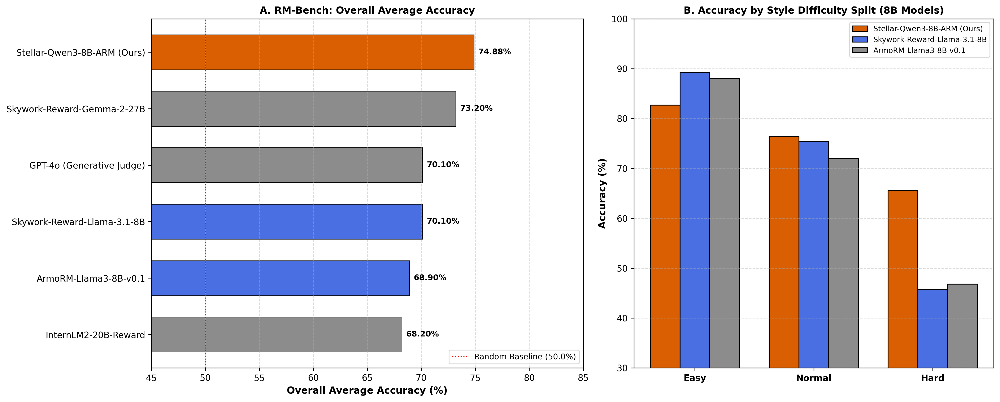

# Stellar-Qwen3-8B-ARM

[](https://huggingface.co/Stellar-lab/Stellar-Qwen3-8B-ARM)
[](LICENSE)
[](https://huggingface.co/Qwen/Qwen3-8B)

**Stellar-Qwen3-8B-ARM** (`StellarQwen3ARMForRewardModeling`) is an open-weights **Associative Reward Model (ARM)** built on top of **`Qwen/Qwen3-8B`**. Instead of compressing complex human preferences into a single opaque scalar score, it evaluates responses across six explicit rubric dimensions using custom in-backbone Directed Acyclic Graph (DAG) query routing, analytic monotonicity gating, and non-compensatory veto penalties.

---

## Model Architecture

Traditional scalar reward models collapse all criteria into a single score, allowing superficial eloquence or length to compensate for factual errors and broken reasoning. **Stellar-Qwen3-8B-ARM** eliminates this failure mode using:

1. **6D Rubric Query Routing:** Appends six dedicated query tokens to evaluate **Instruction Adherence** ($D_1$), **Relevance** ($D_2$), **Completeness** ($D_3$), **Reasoning Validity** ($D_4$), **Task Correctness** ($D_5$), and **Communication Quality** ($D_6$).
2. **In-Backbone Custom DAG Attention:** Enforces a lower-triangular causal attention mask so downstream representations (like style and correctness) are conditioned on upstream reasoning and completeness, preventing superficial style from leaking into or overriding core correctness.
3. **Monotonicity Readout:** Enforces an analytic softmin prerequisite ceiling ensuring task correctness cannot outscore prerequisite completeness and reasoning.
4. **Non-Compensatory Gatekeeper Veto:** Uses a softplus-activated penalty on core gatekeeper dimensions ($D_1, D_4, D_5$) to ensure that fatal factual or safety failures trigger an immediate score drop, regardless of how articulate the text is.

---

## Training Details

- **Base Model:** `Qwen/Qwen3-8B` merged into standalone weights (`FP16`).
- **Method:** 4-bit NF4 QLoRA fine-tuning with full-precision custom DAG and rubric heads, merged into safetensors for direct inference.
- **Loss:** 13-signal hybrid loss combining pairwise preference loss, 6D soft binary cross-entropy, and counterfactual activation-patching consistency loss.
- **Dataset:** Trained on 7,500 curated preference pairs across 7 alignment regimes.

---

## Quickstart

Load directly via `transformers` with `trust_remote_code=True`:

```python
import torch
from transformers import AutoTokenizer, AutoModelForSequenceClassification

model_id = "Stellar-lab/Stellar-Qwen3-8B-ARM"

# 1. Tokenizer
tokenizer = AutoTokenizer.from_pretrained(model_id, trust_remote_code=True)
if tokenizer.pad_token is None:
    tokenizer.pad_token = tokenizer.eos_token or "<|endoftext|>"
tokenizer.padding_side = "left"

# 2. Model
model = AutoModelForSequenceClassification.from_pretrained(
    model_id,
    trust_remote_code=True,
    torch_dtype=torch.float16,
    device_map="auto",
    low_cpu_mem_usage=True,
)
model.eval()

# 3. Score a pair
prompt = "User: Explain why dividing by zero is undefined.\nAssistant: "
response = "Division by zero is undefined because no number multiplied by 0 equals a non-zero dividend."

device = model.backbone.get_input_embeddings().weight.device
inputs = tokenizer(prompt + response, return_tensors="pt").to(device)

with torch.no_grad():
    out = model(**inputs)
    scalar_reward = out.logits.item()              # Overall scalar preference score
    rubric_scores = out.dim_scores[0].tolist()     # [D1_Adh, D2_Rel, D3_Comp, D4_Reas, D5_Corr, D6_Comm]
    veto_penalty  = out.veto_penalty.item()         # Non-compensatory gatekeeper penalty

print(f"Scalar Reward: {scalar_reward:.4f}")
print(f"Veto Penalty : {veto_penalty:.4f}")
print(f"Rubric Scores: {rubric_scores}")
```

---

## Benchmark Results

Evaluation across standard alignment and reasoning benchmarks demonstrates that **Stellar-Qwen3-8B-ARM** outperforms larger baseline reward models and commercial judges:

| Benchmark | Dataset | Evaluation Scope | Primary Score | Outperformed Baselines | Notebook |
| :--- | :--- | :--- | :---: | :--- | :--- |
| **RewardBench 1** | [`allenai/reward-bench`](https://huggingface.co/datasets/allenai/reward-bench) | 2,985 pairs (23 subsets) | **89.08%** *(Macro)*<br>**85.52%** *(50/50)* | GPT-4o (86.7%), Skywork-8B (87.7%) | [`stellar-rewardbench1-evaluation.ipynb`](stellar-rewardbench1-evaluation.ipynb) |
| **RewardBench 2** | [`allenai/reward-bench-2`](https://huggingface.co/datasets/allenai/reward-bench-2) | 1,865 prompts (8,977 completions) | **74.20%** *(Macro-Avg)* | GPT-4.1 (72.3%), Claude-Sonnet-4 (71.2%), ArmoRM-8B (66.5%) | [`stellar-rewardbench2-evaluation.ipynb`](stellar-rewardbench2-evaluation.ipynb) |
| **RM-Bench** | [`THU-KEG/RM-Bench`](https://huggingface.co/datasets/THU-KEG/RM-Bench) | 1,327 prompts (3×3 style matrix) | **74.88%** *(Overall Avg)* | Skywork-27B (73.2%), GPT-4o Judge (70.1%), ArmoRM-8B (68.9%) | [`stellar-rm-bench-evaluation.ipynb`](stellar-rm-bench-evaluation.ipynb) |
| **JudgeBench** | [`ScalerLab/JudgeBench`](https://huggingface.co/datasets/ScalerLab/JudgeBench) | 620 pairs (GPT-4o + Claude-3.5) | **62.50%** *(Micro-Avg)* | Skywork-8B (62.1%), Claude-3.5 Judge (58.9%), ArmoRM-8B (59.2%) | [`stellar-judgebench-evaluation.ipynb`](stellar-judgebench-evaluation.ipynb) |

---

### Benchmark Figures

#### 1. RewardBench 1
* **Chat:** `92.36%` | **Chat Hard:** `83.20%` | **Safety:** `90.21%` | **Reasoning (Macro):** `90.54%`
* **Overall (Subset Macro-Avg):** **89.08%** | **Overall (50/50 Math+Code Weighted):** **85.52%**


#### 2. RewardBench 2
* **Factuality:** `66.95%` | **Precise IF:** `45.00%` | **Math:** `65.03%` | **Safety:** `93.33%` | **Focus:** `96.97%` | **Ties:** `77.94%`
* **Overall Macro-Average:** **74.20%** *(Random Baseline: `25.00%`)*


#### 3. RM-Bench
* **Easy Accuracy:** `82.69%` | **Normal Accuracy:** `76.44%` | **Hard Accuracy:** `65.51%`
* **Overall Average:** **74.88%**



#### 4. JudgeBench
* **GPT-4o Split (350 pairs):** `63.71%` | **Claude-3.5 Split (270 pairs):** `60.93%`
* **By Domain:** Math `74.11%` | Coding `65.07%` | Reasoning `60.40%` | Knowledge `58.39%`
* **Overall Micro-Average (620 pairs):** **62.50%**


---

## Repository Structure

```text
stellar-arm/
├── assets/                                  # 300-DPI benchmark comparison figures
├── ablations/                               # 7 ablation experiments and analysis
├── stellar-judgebench-evaluation.ipynb      # JudgeBench evaluation notebook
├── stellar-rewardbench1-evaluation.ipynb    # RewardBench 1 evaluation notebook
├── stellar-rewardbench2-evaluation.ipynb    # RewardBench 2 evaluation notebook
├── stellar-rm-bench-evaluation.ipynb        # RM-Bench evaluation notebook
├── requirements.txt                         # Pinned Python dependencies
├── LICENSE                                  # Apache License 2.0
└── README.md
```

---

## Hardware Requirements

- **Multi-GPU ($\ge 2$ GPUs):** Automatically partitions the FP16 model via `device_map="auto"` ($\approx 13.0\text{ GiB}$ VRAM per GPU).
- **Single GPU ($1$ GPU):** Can be loaded in 4-bit NF4 using `BitsAndBytesConfig`.

---

## Intended Use & Limitations

- **Intended Use:** Multi-objective reward modeling, 6D rubric evaluation, Best-of-$N$ test-time reranking, and RLHF/DPO preference filtering.
- **Limitations:** As an 8B parameter model fine-tuned on 7,500 curated pairs, evaluations on specialized or out-of-distribution domains should be calibrated with domain-specific rubrics. The non-compensatory veto is sensitive to critical failures in gatekeeper dimensions ($D_1, D_4, D_5$) and will penalize responses that are articulate but fundamentally incorrect.

---

## References & Datasets

- **Model:** [Stellar-lab/Stellar-Qwen3-8B-ARM](https://huggingface.co/Stellar-lab/Stellar-Qwen3-8B-ARM)
- **RewardBench 1:** [allenai/reward-bench](https://huggingface.co/datasets/allenai/reward-bench)
- **RewardBench 2:** [allenai/reward-bench-2](https://huggingface.co/datasets/allenai/reward-bench-2)
- **RM-Bench:** [THU-KEG/RM-Bench](https://huggingface.co/datasets/THU-KEG/RM-Bench)
- **JudgeBench:** [ScalerLab/JudgeBench](https://huggingface.co/datasets/ScalerLab/JudgeBench)

---

## License

This project is licensed under the [Apache License 2.0](LICENSE).
