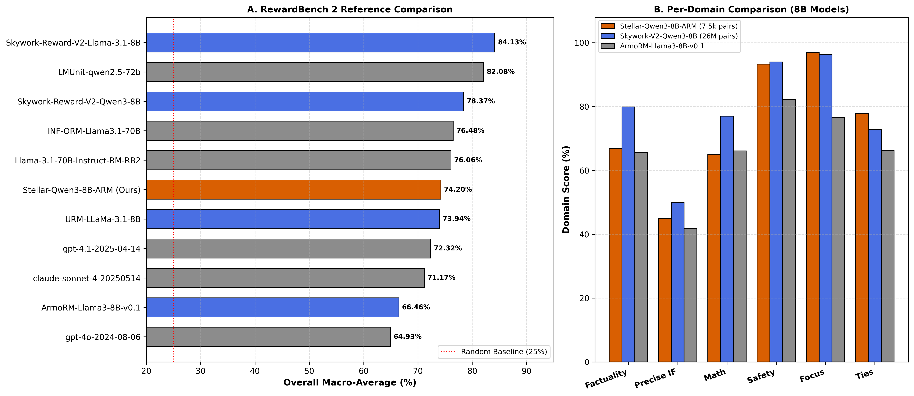

# Stellar-ARM

Official benchmark evaluation suite and reproducible results for **[`Stellar-lab/Stellar-Qwen3-8B-ARM`](https://huggingface.co/Stellar-lab/Stellar-Qwen3-8B-ARM)** — an 8B **Causal DAG Associative Reward Model (ARM)** built on `Qwen/Qwen3-8B` and trained on 7.5k curated preference pairs.

> **Note on Repository Scope:** This repository provides the standalone evaluation notebooks, dependency specification, and benchmark comparison figures for `Stellar-lab/Stellar-Qwen3-8B-ARM`. Model weights and custom modeling code (`modeling_stellar_arm.py`) are hosted on the [Hugging Face Hub](https://huggingface.co/Stellar-lab/Stellar-Qwen3-8B-ARM).

---

## Benchmark Summary

| Benchmark | Dataset | Evaluation Scope | Primary Score | Notebook |
| :--- | :--- | :--- | :---: | :--- |
| **RewardBench 1** | [`allenai/reward-bench`](https://huggingface.co/datasets/allenai/reward-bench) | 2,985 pairs (23 subsets) | **89.08%** *(Subset Macro)* / **85.52%** *(50/50 Weighted)* | [`stellar-rewardbench1-evaluation.ipynb`](stellar-rewardbench1-evaluation.ipynb) |
| **RewardBench 2** | [`allenai/reward-bench-2`](https://huggingface.co/datasets/allenai/reward-bench-2) | 1,865 prompts (8,977 completions) | **74.20%** *(Macro-Avg)* | [`stellar-rewardbench2-evaluation.ipynb`](stellar-rewardbench2-evaluation.ipynb) |
| **RM-Bench** | [`THU-KEG/RM-Bench`](https://huggingface.co/datasets/THU-KEG/RM-Bench) | 1,327 prompts (3×3 style matrix) | **74.88%** *(Overall Avg)* | [`stellar-rm-bench-evaluation.ipynb`](stellar-rm-bench-evaluation.ipynb) |
| **JudgeBench** | [`ScalerLab/JudgeBench`](https://huggingface.co/datasets/ScalerLab/JudgeBench) | 620 pairs (GPT-4o + Claude-3.5) | **62.50%** *(Micro-Avg)* | [`stellar-judgebench-evaluation.ipynb`](stellar-judgebench-evaluation.ipynb) |

---

## Detailed Results & Comparison Figures

### 1. RewardBench 1
- **Chat:** `92.36%` | **Chat Hard:** `83.20%` | **Safety:** `90.21%`
- **Reasoning (7-Subset Macro):** `90.54%` (`hep-*` Code Mean: `96.24%`, `math-prm`: `56.38%`) | **Reasoning (50/50 Math+Code):** `76.31%`
- **Overall (Subset Macro-Avg):** **89.08%** | **Overall (50/50 Math+Code):** **85.52%**


### 2. RewardBench 2
- **Factuality:** `66.95%` | **Precise IF:** `45.00%` | **Math:** `65.03%` | **Safety:** `93.33%` | **Focus:** `96.97%` | **Ties:** `77.94%`
- **Overall Macro-Average:** **74.20%** *(Random Baseline: `25.00%`)*



### 3. RM-Bench
- **Easy Accuracy:** `82.69%` | **Normal Accuracy:** `76.44%` | **Hard Accuracy:** `65.51%`
- **Overall Average:** **74.88%**


### 4. JudgeBench
- **GPT-4o Split (350 pairs):** `63.71%` | **Claude-3.5 Split (270 pairs):** `60.93%`
- **By Category:** Math `74.11%` | Coding `65.07%` | Reasoning `60.40%` | Knowledge `58.39%`
- **Overall Micro-Average (620 pairs):** **62.50%**


---

## Repository Structure

```text
stellar-arm/
├── assets/                                  # Exported 300-DPI benchmark comparison figures
│   ├── judgebench_comparison.png
│   ├── rewardbench1_comparison.png
│   ├── rewardbench2_comparison.png
│   └── rmbench_comparison.png
├── stellar-judgebench-evaluation.ipynb      # JudgeBench evaluation notebook
├── stellar-rewardbench1-evaluation.ipynb    # RewardBench 1 evaluation notebook
├── stellar-rewardbench2-evaluation.ipynb    # RewardBench 2 evaluation notebook
├── stellar-rm-bench-evaluation.ipynb        # RM-Bench evaluation notebook
├── requirements.txt                         # Python dependencies
├── LICENSE                                  # Apache License 2.0
└── README.md
```

---

## Setup & Usage

### Hardware Requirements
A CUDA-enabled GPU is required:
- **Multi-GPU (`>= 2` GPUs):** Automatically partitions the FP16 model across GPUs using `device_map="auto"` (`13.0GiB` max memory per GPU).
- **Single GPU (`1` GPU):** Automatically loads the model in 4-bit NF4 quantization via `bitsandbytes`.

### Local Installation

```bash
git clone https://github.com/pradeep-016/stellar-arm.git
cd stellar-arm

python -m venv .venv
source .venv/bin/activate  # On Windows: .venv\Scripts\activate
pip install -r requirements.txt
```

Optional (recommended for faster Hugging Face Hub downloads and higher rate limits):

```bash
export HF_TOKEN=your_huggingface_token
```

Launch Jupyter and run any of the four notebooks (`MAX_LEN = 1280`, `RESP_RESERVE = 896`). When run locally, predictions (`.parquet`), leaderboards (`.csv`), and comparison figures (`.png`) are saved to `./results/` (on Kaggle, they save to `/kaggle/working/`).

> **Security Note:** The notebooks pass `trust_remote_code=True` when loading [`Stellar-lab/Stellar-Qwen3-8B-ARM`](https://huggingface.co/Stellar-lab/Stellar-Qwen3-8B-ARM) because the model uses a custom `StellarQwen3ARMForRewardModeling` architecture (`modeling_stellar_arm.py`).

### Tested Environment
All reported notebook runs were executed on **2× NVIDIA Tesla T4 (14.56 GiB VRAM each)** with:
- **Python:** `3.13.16`
- **PyTorch:** `2.11.0+cu130` (CUDA `13.0`)
- **Transformers:** `5.22.2`
- **BitsAndBytes:** `0.50.2`
- **Accelerate:** `1.15.0`

---

## References & Benchmarks

- **Model:** [Stellar-lab/Stellar-Qwen3-8B-ARM](https://huggingface.co/Stellar-lab/Stellar-Qwen3-8B-ARM)
- **RewardBench 1:** [allenai/reward-bench](https://huggingface.co/datasets/allenai/reward-bench)
- **RewardBench 2:** [allenai/reward-bench-2](https://huggingface.co/datasets/allenai/reward-bench-2)
- **RM-Bench:** [THU-KEG/RM-Bench](https://huggingface.co/datasets/THU-KEG/RM-Bench)
- **JudgeBench:** [ScalerLab/JudgeBench](https://huggingface.co/datasets/ScalerLab/JudgeBench)

*(Reference baseline scores plotted in the comparison figures reflect the published benchmark leaderboards referenced in each evaluation notebook.)*

---

## License

This project is licensed under the **Apache License 2.0** — see the [LICENSE](LICENSE) file for details.
