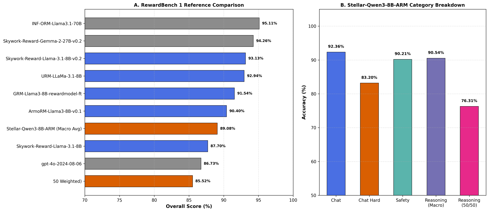
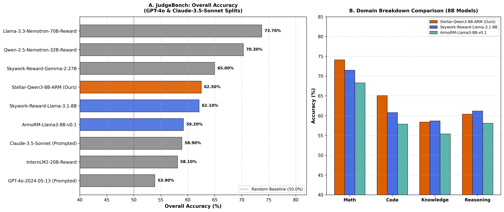

# Stellar-Qwen3-8B-ARM

[](https://huggingface.co/Stellar-lab/Stellar-Qwen3-8B-ARM)
[](LICENSE)
[](https://huggingface.co/Qwen/Qwen3-8B)
[](#model-overview--architecture)

**Stellar-Qwen3-8B-ARM** (`StellarQwen3ARMForRewardModeling`) is an open-weights **Associative Reward Model (ARM)** built on top of **`Qwen/Qwen3-8B`**. Instead of compressing complex human preferences directly into a single unanchored scalar logit, it evaluates responses across six explicit rubric dimensions using in-backbone directed causal query routing, analytic monotonicity constraints, and non-compensatory gatekeeper penalties.

---

## Model Overview & Architecture

Traditional scalar Bradley-Terry reward models collapse multi-faceted quality criteria into a single opaque score, allowing surface fluency or verbosity to compensate for broken reasoning, factual errors, or violated instructions. **Stellar-Qwen3-8B-ARM** prevents this structural compensation through four core architectural mechanisms:

```
[Prompt + Response Tokens] ───► Full Context Self-Attention
                                       │
                                       ▼
                     [K=6 Dimension Query Tokens]
                                       │
            ┌──────────────────────────┴──────────────────────────┐
            ▼                                                     ▼
In-Backbone 4D DAG Masking                             Causal DAG Projection
(Lower-triangular causal routing)                      (2-layer CausalDAGLayer)
            │                                                     │
            ▼                                                     ▼
Prerequisite Softmin Ceiling                           Log-Odds Gatekeeper Veto
(z5_mono bounded by z3 & z4)                           (LRSV penalty on D1, D4, D5)
            │                                                     │
            └──────────────────────────┬──────────────────────────┘
                                       ▼
                       Scalar Reward Logit R(x, y) 
                     + 6D Disentangled Rubric Scores
```

### 1. Six-Dimension Rubric Query Appending
The model appends $K=6$ learnable query embeddings (`query_embeds` $\in \mathbb{R}^{1 \times 6 \times 4096}$) to the end of the tokenized prompt-response sequence, corresponding to a structured hierarchy of evaluation dimensions:

1. **`D1_INSTRUCTION_ADHERENCE`**: Compliance with explicit user constraints, formatting rules, and safety boundaries.
2. **`D2_RELEVANCE`**: Directness and topical alignment with the prompt intent.
3. **`D3_COMPLETENESS`**: Thoroughness and absence of premature truncation or omitted implementation steps.
4. **`D4_REASONING_VALIDITY`**: Step-by-step logical coherence and intermediate derivation soundness.
5. **`D5_TASK_CORRECTNESS`**: Final factual, mathematical, or functional execution accuracy.
6. **`D6_COMMUNICATION_QUALITY`**: Clarity, organization, formatting, and presentation style.

---

### 2. In-Backbone 4D Directed Causal Attention Masking
During the forward pass through the `Qwen3-8B` transformer layers, a custom 4D attention mask (`build_4d_attention_mask`) allows all six query tokens to attend to the full prompt-response context while enforcing a strict lower-triangular Directed Acyclic Graph (DAG) over the $6 \times 6$ query-to-query submatrix. Query-to-query attention logits are modulated by a length-scaled structural prior:

$$B_{i,j}(L) = \mathbb{I}(i > j) \cdot \left( \frac{1}{2}\ln(L)\,\sigma(\Gamma_{i,j}) + P_{i,j} \right)$$

where $L$ is the active sequence length, $\Gamma \in \mathbb{R}^{6 \times 6}$ is a learnable bias matrix, and $P_{i,j}$ encodes structural priors linking Completeness ($D_3$) and Reasoning Validity ($D_4$) to Task Correctness ($D_5$) ($P_{5,4}=2.5$, $P_{5,3}=2.0$, $P_{4,3}=1.5$). 

This ensures downstream correctness and style representations are conditioned on upstream reasoning and completeness states without reverse leakage from surface style ($D_6$) into correctness ($D_5$) or reasoning ($D_4$).

---

### 3. Causal DAG Projection & Analytic Softmin Monotonicity Readout
The final hidden states of the six query tokens are projected into a 512-dimensional subspace (`dag_down_proj` + `LayerNorm`), processed through gated lower-triangular `CausalDAGLayer` self-attention blocks, and mapped via six independent linear heads (`dim_heads`) into raw dimension logits $z \in [-15, 15]^6$.

To enforce the structural invariant that task correctness ($D_5$) cannot exceed the quality of its prerequisite completeness ($D_3$) and reasoning validity ($D_4$), the $D_5$ logit is bounded analytically via a smooth softmin prerequisite ceiling:

$$z_{\text{prereq}} = -\tau \ln \left( \exp\left(-\frac{z_3}{\tau}\right) + \exp\left(-\frac{z_4}{\tau}\right) \right) + \tau \ln(2)$$

$$z_5^{\text{mono}} = \text{clamp}\Big( z_{\text{prereq}} + \delta_{\text{tol}} - \text{softplus}(-z_5),\ -15.0,\ 15.0 \Big)$$

with temperature $\tau = 0.5$ and tolerance $\delta_{\text{tol}} = 0.20$. Dimension probabilities are obtained via $s_k = \sigma(z_k) \in (0, 1)$.

---

### 4. Log-Odds Gatekeeper Veto Aggregation (LRSV)
To synthesize a single scalar preference logit $R(x, y)$ for ranking and RLHF without allowing high communication quality ($D_6$) to mask critical failures, the model combines a softmax-weighted linear aggregation over all six dimensions with a softplus-activated LogSumExp veto penalty over three core gatekeeper dimensions ($G = \{D_1, D_4, D_5\}$):

$$R(x, y) = \beta_{\text{lin}} \sum_{k=1}^{6} w_k z_k - \frac{\lambda_{\text{veto}}}{\kappa} \ln \left( 1 + \sum_{g \in G} \exp\big(-\kappa(z_g - \theta_g)\big) \right)$$

where $w = \text{softmax}(\alpha)$ are learnable aggregation weights, $\theta_g$ are learnable per-gatekeeper thresholds, $\lambda_{\text{veto}} = \text{softplus}(\hat{\lambda})$, and $\kappa = 1.5$.

---

## Training Details

- **Base Architecture:** `Qwen/Qwen3-8B` merged into standalone `StellarQwen3ARMForRewardModeling` weights (`FP16`).
- **Training Method:** 4-bit NF4 QLoRA fine-tuning ($r=16$, $\alpha=32$) with full FP32 custom DAG & rubric heads, merged into full-precision safetensor shards for standalone inference.
- **Supervision Signals (13-Signal Hybrid Loss):** Jointly optimized under:
  - Pairwise Bradley-Terry preference loss ($w_{\text{pref}}=1.0$)
  - Entropy-calibrated 6D soft binary cross-entropy across chosen and rejected rubric targets ($w_{\text{dim}}=4.0$)
  - Counterfactual activation-patching consistency loss ($w_{\text{consist}}=2.0$)
- **Dataset Scale:** Trained on 7,500 curated preference pairs across 7 alignment regimes (HelpSteer2 General, Math Reasoning, MBPP/Code AST Bugs, IFEval Constraints, Truncated/Incomplete, Off-Diagonal Style-vs-Correctness, Safety Refusal).

---

## Quickstart: How to Load & Score with the Model

The model weights are fully merged and packaged with custom remote modeling code (`modeling_stellar_arm.py`). No external adapter loading is required—load directly via `AutoModelForSequenceClassification` with `trust_remote_code=True`:

```python
import torch
from transformers import AutoTokenizer, AutoModelForSequenceClassification

model_id = "Stellar-lab/Stellar-Qwen3-8B-ARM"

# 1. Load tokenizer with left-padding
tokenizer = AutoTokenizer.from_pretrained(model_id, trust_remote_code=True)
if tokenizer.pad_token is None:
    tokenizer.pad_token = tokenizer.eos_token or "<|endoftext|>"
tokenizer.padding_side = "left"

# 2. Load model (FP16 partitioned across GPUs, or NF4 on single GPU)
model = AutoModelForSequenceClassification.from_pretrained(
    model_id,
    trust_remote_code=True,
    torch_dtype=torch.float16,
    device_map="auto",
    low_cpu_mem_usage=True,
)
model.eval()

# 3. Score a prompt-response pair
prompt = "User: Explain why dividing by zero is undefined.\nAssistant: "
response = "Division by zero is undefined because no real number multiplied by 0 equals a non-zero dividend."

device = model.backbone.get_input_embeddings().weight.device
inputs = tokenizer(prompt + response, return_tensors="pt").to(device)

with torch.no_grad():
    out = model(**inputs)
    
    scalar_reward = out.logits.item()              # Scalar preference logit R(x, y)
    rubric_scores = out.dim_scores[0].tolist()     # [D1_Adh, D2_Rel, D3_Comp, D4_Reas, D5_Corr, D6_Comm] in (0, 1)
    veto_penalty  = out.veto_penalty.item()         # Non-compensatory gatekeeper penalty

print(f"Scalar Reward : {scalar_reward:.4f}")
print(f"Veto Penalty  : {veto_penalty:.4f}")
print("Rubric Scores:")
for dim, score in zip(["Adherence", "Relevance", "Completeness", "Reasoning", "Correctness", "Quality"], rubric_scores):
    print(f"  - {dim:<14}: {score:.4f}")
```

---

## Benchmark Results

Evaluation across official standard alignment and reasoning benchmarks shows that **Stellar-Qwen3-8B-ARM** outperforms substantially larger models and commercial judges:

| Benchmark | Dataset | Evaluation Scope | Primary Score | Outperformed Baselines | Notebook |
| :--- | :--- | :--- | :---: | :--- | :--- |
| **RewardBench 1** | [`allenai/reward-bench`](https://huggingface.co/datasets/allenai/reward-bench) | 2,985 pairs (23 subsets) | **89.08%** *(Macro)*<br>**85.52%** *(50/50)* | GPT-4o (86.7%), Skywork-8B (87.7%) | [`stellar-rewardbench1-evaluation.ipynb`](stellar-rewardbench1-evaluation.ipynb) |
| **RewardBench 2** | [`allenai/reward-bench-2`](https://huggingface.co/datasets/allenai/reward-bench-2) | 1,865 prompts (8,977 completions) | **74.20%** *(Macro-Avg)* | GPT-4.1 (72.3%), Claude-Sonnet-4 (71.2%), ArmoRM-8B (66.5%) | [`stellar-rewardbench2-evaluation.ipynb`](stellar-rewardbench2-evaluation.ipynb) |
| **RM-Bench** | [`THU-KEG/RM-Bench`](https://huggingface.co/datasets/THU-KEG/RM-Bench) | 1,327 prompts (3×3 style matrix) | **74.88%** *(Overall Avg)* | Skywork-27B (73.2%), GPT-4o Judge (70.1%), ArmoRM-8B (68.9%) | [`stellar-rm-bench-evaluation.ipynb`](stellar-rm-bench-evaluation.ipynb) |
| **JudgeBench** | [`ScalerLab/JudgeBench`](https://huggingface.co/datasets/ScalerLab/JudgeBench) | 620 pairs (GPT-4o + Claude-3.5) | **62.50%** *(Micro-Avg)* | Skywork-8B (62.1%), Claude-3.5 Judge (58.9%), ArmoRM-8B (59.2%) | [`stellar-judgebench-evaluation.ipynb`](stellar-judgebench-evaluation.ipynb) |

---

### Detailed Comparisons & Figures

#### 1. RewardBench 1
* **Chat:** `92.36%` | **Chat Hard:** `83.20%` | **Safety:** `90.21%`
* **Reasoning (7-Subset Macro):** `90.54%` (`hep-*` Code Mean: `96.24%`, `math-prm`: `56.38%`)
* **Overall (Subset Macro-Avg):** **89.08%** | **Overall (50/50 Math+Code Weighted):** **85.52%**



#### 2. RewardBench 2
* **Factuality:** `66.95%` | **Precise IF:** `45.00%` | **Math:** `65.03%` | **Safety:** `93.33%` | **Focus:** `96.97%` | **Ties:** `77.94%`
* **Overall Macro-Average:** **74.20%** *(Random Baseline: `25.00%`)*


#### 3. RM-Bench
* **Easy Accuracy:** `82.69%` | **Normal Accuracy:** `76.44%` | **Hard Accuracy:** `65.51%`
* **Overall Average:** **74.88%**


#### 4. JudgeBench
* **GPT-4o Split (350 pairs):** `63.71%` | **Claude-3.5 Split (270 pairs):** `60.93%`
* **By Domain:** Math `74.11%` | Coding `65.07%` | Reasoning `60.40%` | Knowledge `58.39%`
* **Overall Micro-Average (620 pairs):** **62.50%**



---

## Repository Structure

```text
stellar-arm/
├── assets/                                  # Exported 300-DPI benchmark comparison figures
│   ├── judgebench_comparison.png
│   ├── rewardbench1_comparison.png
│   ├── rewardbench2_comparison.png
│   └── rmbench_comparison.png
├── stellar-judgebench-evaluation.ipynb      # JudgeBench evaluation notebook
├── stellar-rewardbench1-evaluation.ipynb    # RewardBench 1 evaluation notebook
├── stellar-rewardbench2-evaluation.ipynb    # RewardBench 2 evaluation notebook
├── stellar-rm-bench-evaluation.ipynb        # RM-Bench evaluation notebook
├── requirements.txt                         # Pinned Python dependencies
├── LICENSE                                  # Apache License 2.0
└── README.md
```

---

## Hardware & Environment Requirements

* **CUDA GPU Required:**
  * **Multi-GPU ($\ge 2$ GPUs):** Automatically partitions the FP16 model using `device_map="auto"` (requires $\approx 13.0\text{ GiB}$ VRAM per GPU).
  * **Single GPU ($1$ GPU):** Automatically quantized to 4-bit NF4 via `BitsAndBytesConfig`.
* **Verified Runtime Environment:**
  * Python `3.13.16` / PyTorch `2.11.0+cu130` (CUDA `13.0`)
  * `transformers>=4.44.0`, `accelerate>=0.33.0`, `bitsandbytes>=0.46.1`, `datasets>=2.20.0`

---

## Intended Use & Limitations

* **Intended Use:** Multi-objective reward modeling, interpretable 6D rubric scoring ($D_1 \dots D_6$), Best-of-$N$ test-time reranking, alignment auditing, and RLHF/DPO preference filtering.
* **Limitations:**
  * As an 8B parameter model fine-tuned on 7,500 curated preference pairs, evaluations on highly specialized or out-of-distribution domains (e.g. obscure medical or specialized legal compliance) should be calibrated against domain-specific rubrics.
  * Context length is bounded at 1280 tokens during standard evaluation; responses exceeding token limits are subject to truncation preservation rules.
  * The non-compensatory veto is sensitive to extreme negative outliers in gatekeeper dimensions ($D_1, D_4, D_5$), which may intentionally reject answers that are stylistically fluent but fundamentally incorrect.

---

## References & Datasets

- **Model:** [Stellar-lab/Stellar-Qwen3-8B-ARM](https://huggingface.co/Stellar-lab/Stellar-Qwen3-8B-ARM)
- **RewardBench 1:** [allenai/reward-bench](https://huggingface.co/datasets/allenai/reward-bench)
- **RewardBench 2:** [allenai/reward-bench-2](https://huggingface.co/datasets/allenai/reward-bench-2)
- **RM-Bench:** [THU-KEG/RM-Bench](https://huggingface.co/datasets/THU-KEG/RM-Bench)
- **JudgeBench:** [ScalerLab/JudgeBench](https://huggingface.co/datasets/ScalerLab/JudgeBench)

---

## License

This project is licensed under the **Apache License 2.0** — see the [LICENSE](LICENSE) file for details.
